# AI Welfare Assistant: complete system and flow guide

Implementation walkthrough · 10 November 2026

This guide describes the checked-in implementation, rather than an idealised future architecture. Read sections 1–7 first for the foundations, 8–17 for decision and storage mechanics, and 18–25 for advanced engineering considerations. Diagrams use Mermaid: open this Markdown in a Mermaid-capable preview, such as GitHub or a suitable editor extension. The surrounding text and tables also explain each diagram.

This is a system-design guide. The source index at the end leads to the exact code for subsequent line-by-line lessons. It does not reproduce every source line.

## Contents

1. What the system is
2. Basic engineering vocabulary
3. Overall architecture
4. Every source component
5. Student startup and session creation
6. Browser message lifecycle
7. API endpoints and HTTP boundary
8. Normal message processing
9. Immediate-danger fast path
10. Model request, context and retry conditions
11. Proposal schema and final decision
12. Complete policy decision tree
13. Reply validation and fallback tree
14. Local risk detection
15. Knowledge base and resource cards
16. Database model and invariants
17. Transactions, retries and abandoned requests
18. Case creation and priority accumulation
19. Staff authentication and dashboard
20. Claiming, resolving and concurrency
21. Errors, security and privacy boundaries
22. Configuration, migration and deployment
23. Tests and evidence
24. Worked examples and limitations
25. Reading order and glossary

## 1. What the system is

The application helps students find approved university guidance and routes needs requiring human attention into a staff queue. It has two user journeys: student chat and staff case handling.

It is one Next.js application containing both UI and server endpoints, plus a PostgreSQL database and an external Gemini API. It is not a custom-trained model. The application supplies instructions, approved facts and recent dialogue to an existing model, then checks the proposal in ordinary TypeScript code.

The core authority rule is **the model proposes; the server decides**. A model proposal can suggest category, urgency, safeguarding, a reply and escalation. It cannot claim or resolve a staff case. Those operations belong to authenticated staff endpoints.

Four outcomes are possible for a student turn:

| Outcome | Meaning | Creates/updates a staff case? |
|---|---|---|
| `handle_now` | Answer or signpost using approved guidance, or respond to small talk | No |
| `clarify` | Ask for more context | No |
| `escalate` | Save the need for staff attention | Yes, when the turn is completed successfully |
| `ignored` | Return a boundary response to nuisance/manipulation | No |

An escalated case is a database record visible to staff. The current application does not send email, page on-call staff or ensure a human has read it.

## 2. Basic engineering vocabulary

| Term | Meaning here |
|---|---|
| Browser/client | React UI executing on the student's or staff member's computer |
| Server | Node.js execution handling requests and accessing secrets/database |
| Endpoint | An HTTP address plus method, such as `POST /api/chat` |
| Request | Method, URL, headers, cookies and optional body sent to server |
| Response | Status, headers and optional body returned by server |
| JSON | Text format carrying objects, arrays and values across HTTP |
| Schema | Runtime rules determining whether received data has the required structure |
| Session | Credential-backed association between requests and an identity/conversation |
| Cookie | Browser-managed value automatically attached to matching requests |
| Service | Module coordinating application operations rather than HTTP formatting |
| Transaction | Database work committed together or rolled back together |
| Row lock | Database coordination preventing conflicting work on the same row |
| Idempotency | Repeating the same operation identifier returns the saved effect rather than duplicating it |
| Pool | Reusable collection of database connections |
| Audit | Stored evidence of model proposal/provider outcome; distinct from an access audit log |

`src/lib` is an ordinary directory convention. It does not create URLs. `src/app/**/route.ts` files create HTTP routes through Next.js conventions. Client-side TypeScript types are not runtime validation of server responses.

## 3. Overall architecture

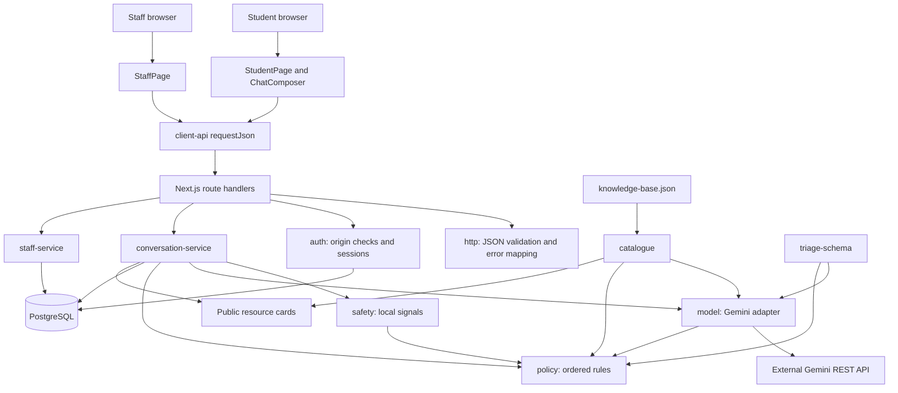

The browser crosses an HTTP trust boundary to reach the server. The server crosses another trust boundary to call Gemini. Database access and provider credentials remain server-side. `safety.ts` is intentionally used on both sides. Type-only imports from service modules in the UI do not execute those server modules in the browser.

## 4. Every source component

Paths are relative to the repository root.

| Component | Responsibility and important functions |
|---|---|
| `src/app/layout.tsx` | Shared HTML document, English language, metadata, global stylesheet |
| `src/app/globals.css` | Visual layout, message cards, queue badges, responsive presentation and animation |
| `src/app/page.tsx` | StudentPage; startup `load`, send/retry lifecycle, transcript, resources, emergency banner, contact form |
| `src/app/chat-composer.tsx` | Controlled textarea, keyboard submission, IME protection, resizing and focus restoration |
| `src/app/staff/page.tsx` | StaffPage; session restoration, login, polling, selection, claim/resolve and logout |
| `src/app/api/chat/route.ts` | Validate and authenticate a message; call service; schedule crisis audit with `after` |
| `src/app/api/conversations/route.ts` | POST session/transcript and PATCH name/email |
| `src/app/api/staff/session/route.ts` | GET identity, POST login, DELETE logout |
| `src/app/api/staff/cases/route.ts` | Authenticated GET priority queue |
| `src/app/api/staff/cases/[id]/route.ts` | Validate UUID route parameter; GET case details; PATCH claim/resolve |
| `src/lib/client-api.ts` | `requestJson<T>` wraps fetch, JSON handling and readable errors |
| `src/lib/http.ts` | `HttpError`, `readJson`, `api` |
| `src/lib/auth.ts` | `checkOrigin`, `studentSession`, `signInStaff`, `signOutStaff`, `staffSession`; hashing and signing helpers |
| `src/lib/db.ts` | Lazy shared `database()` pool; `transaction()` helper |
| `src/lib/conversation-service.ts` | `publicTurn`, `transcript`, `sendMessage`, `auditCrisisTurn`; case upsert/completion helpers |
| `src/lib/staff-service.ts` | `listCases`, `caseDetail`, `claimCase`, `resolveCase`, conditional `CLAIM_SQL` |
| `src/lib/model.ts` | `redact`, `callGemini`, `proposeReply`; instructions and timeout/retry logic |
| `src/lib/triage-schema.ts` | Proposal schema, Decision/Proposal types, urgency ordering |
| `src/lib/policy.ts` | `checkedDraft`, `applyPolicy`, escalation/ignored/summary builders |
| `src/lib/safety.ts` | `riskSignals`, `looksLikeSpam`, shared emergency wording |
| `src/lib/catalogue.ts` | Approved entries, model guidance projection, outage hints, resource-card projection |
| `src/data/knowledge-base.json` | 13 approved guidance entries with IDs, facts and destinations |
| `db/001-initial.sql` | Tables, foreign keys, checks, unique constraints and partial indexes |
| `scripts/migrate.mjs` | Transactional, lock-protected application of the initial migration |
| `tests/fixtures.ts` | Recorded proposals and assessment examples |
| `tests/policy.test.ts` | Deterministic policy behavior checks |
| `tests/probes.test.ts` | Required manipulation and crisis probes using deliberately wrong/unavailable model proposals |
| `tests/integration/run.ts` | Isolated-schema service/database checks; optional real HTTP checks |
| `tests/evaluation/run.ts` | Live model evaluation and report generation |
| `docs/model-evaluation.json` | Recorded evaluation output, not a runtime dependency |
| `package.json` | Dependencies and executable commands |
| `tsconfig.json` | Strict TypeScript, bundler module resolution, JSON imports, JSX and Next.js integration |
| `next-env.d.ts` | Next.js type declarations |
| `tsconfig.tsbuildinfo` | Incremental compiler cache; not application behavior |
| `README.md`, `DECISIONS.md`, `docs/ARCHITECTURE.md` | Setup, design rationale and earlier architecture explanation |
| `AGENTS.md` | Instructions for coding agents; not application runtime |

The repository also includes assessment/report PDFs and personal notes. They are reference artifacts rather than modules invoked by requests. This guide is derived from implementation; it does not claim to verify every statement in those PDFs.

## 5. Student startup and session creation

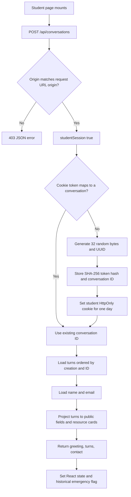

The cookie holds the raw random token. PostgreSQL stores only its hash. Possession of a database hash alone does not reveal the original bearer credential. A stolen raw cookie still grants access to its conversation.

Student sessions do not require a name/password. The optional contact form is separate so message submission is not blocked by registration. `PATCH /api/conversations` requires an existing session, validates trimmed name length 1–100 and email format/length up to 254, updates only that conversation and returns `{saved:true}`. It never calls the model.

Student expiry is set on the cookie; there is no expiry column or automated conversation deletion in the schema.

## 6. Browser message lifecycle

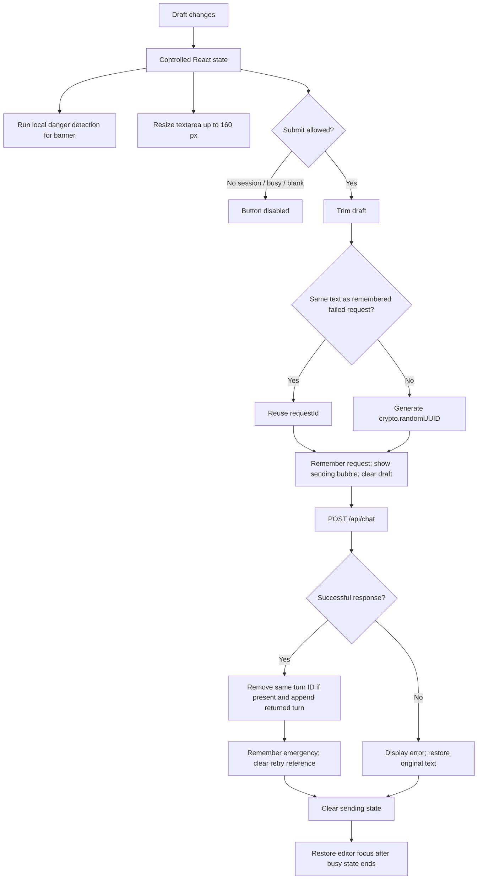

Enter sends only when not Shift+Enter, not IME composition, not legacy composition key code 229, not a repeated key event, and ready/not busy/nonblank. Shift+Enter inserts a newline. The textarea is read-only while sending and has a 2,000-character limit; the server independently validates text.

The typing component changes its message after six seconds and cleans up its timer on unmount. Transcript changes scroll the end marker into view. Emergency state persists after a dangerous sent/received turn; transient dangerous draft text also displays a banner.

`Bubble` renders text as React text content, not injected HTML. `AssistantTurn` supplies pending fallback wording, escalation label and resource cards. `ContactPanel` independently owns name/email and save status.

`requestJson` sends JSON headers/body when its `body` argument is truthy, uses `cache:'no-store'`, and relies on same-origin fetch cookies. JSON parse failure becomes an empty object; a non-2xx response throws a readable error. `T` is a compile-time assertion, not response validation: a 2xx HTML/malformed response can incorrectly be accepted as `{}`.

## 7. API endpoints and HTTP boundary

| Method and endpoint | Checks, in actual order | Operation/result |
|---|---|---|
| POST `/api/conversations` | Origin → create/restore student session | Greeting, public transcript and contact |
| PATCH `/api/conversations` | Origin → student session → contact JSON schema | Update name/email; saved flag |
| POST `/api/chat` | Origin → message JSON schema → student session | Process message; return `{turn}`; optional deferred audit |
| GET `/api/staff/session` | Signed staff session | `{staffId}` |
| POST `/api/staff/session` | Origin → credentials JSON schema → configured password comparison | Set cookie; return staff ID |
| DELETE `/api/staff/session` | Origin | Delete staff cookie; signed-out flag |
| GET `/api/staff/cases` | Staff session | `{cases}` ordered queue |
| GET `/api/staff/cases/:id` | Staff session → UUID path schema | Case plus conversation turns |
| PATCH `/api/staff/cases/:id` | Origin → staff session → UUID → action JSON schema | Claim or resolve; return case row |

The dynamic route awaits `context.params`, which is a Promise in this implementation. All routes select Node.js. Chat declares `maxDuration=30`; this is hosting configuration, not a local cancellation timer.

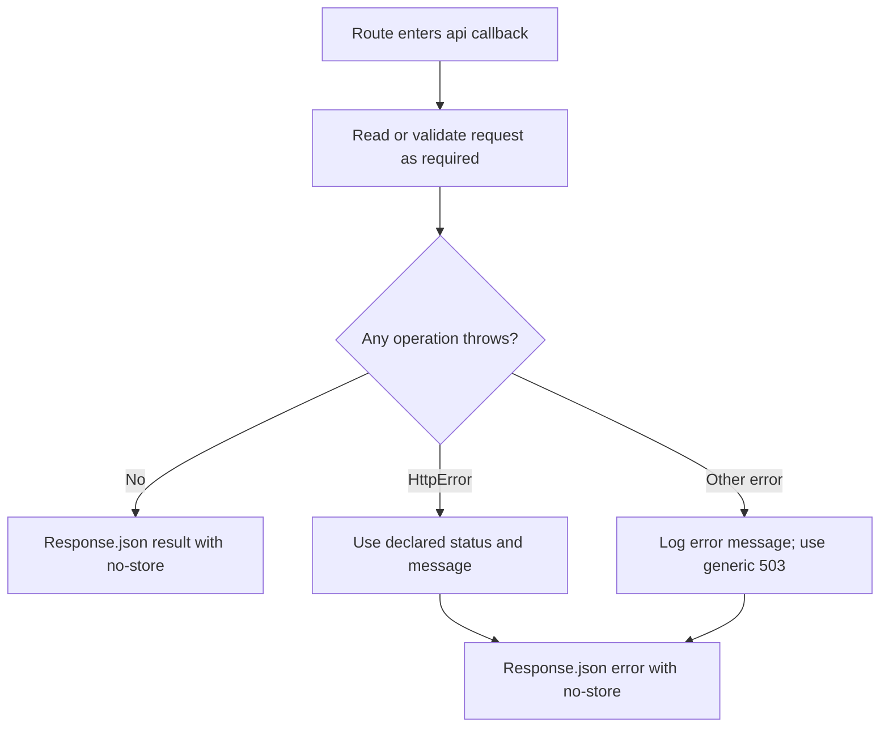

`readJson` reads `request.text()`, rejects `raw.length > 16000`, parses JSON into `unknown`, then uses `schema.safeParse`. Oversized length is 413; invalid JSON or invalid schema is 400. Despite the constant name `MAX_BODY_BYTES`, this checks JavaScript string length after buffering the entire body, not streamed byte size.

Chat schema: strict object with trimmed string `text` length 1–2,000 and UUID `requestId`. Extra properties are rejected. Credentials schema: staff ID `alex` or `bea`, password length 1–200. Action schema: only `claim` or `resolve`.

## 8. Normal message processing

```mermaid
sequenceDiagram
  participant B as Browser
  participant R as Chat route
  participant S as Conversation service
  participant D as PostgreSQL
  participant M as Model adapter
  participant P as Policy
  B->>R: POST text and requestId, cookie
  R->>R: Origin, JSON schema, session lookup
  R->>S: sendMessage(conversationId, requestId, text)
  S->>D: BEGIN; lock conversation row
  S->>D: Recover stale pending turns; inspect requestId
  S->>D: Check pending turn; insert pending turn
  S->>D: COMMIT
  S->>D: Load last three completed turns
  S->>S: Build chronological history and clarification count
  S->>M: Text and history, no open transaction
  M-->>S: Raw proposal and provider metadata
  S->>P: applyPolicy(text, raw, clarificationCount)
  P-->>S: Final Decision
  S->>D: Check open case and contact when escalated
  S->>D: BEGIN; complete pending turn and upsert case if escalated; COMMIT
  S->>D: Read saved turn
  S-->>R: Public turn, needsAudit false
  R-->>B: 200 JSON
```

The first transaction protects reservation. The model call happens after that transaction commits. Holding a database connection/row lock through a slow model request would reduce throughput and block other work for that conversation.

History takes the latest three completed turns, reverses them into chronological order, and expands each into user/assistant messages. This is at most six dialogue messages, followed by the latest student message separately. Clarification count walks backward over those turns until the first non-clarify decision; unrelated older clarifications do not consume the current consecutive limit.

The stored decision adds `audit:{providerStatus, attempts, model, proposal}` to the policy result. For ordinary escalation, wording changes to an existing-request acknowledgement if an open case is observed. Missing name or email appends a request to use the contact panel.

## 9. Immediate-danger fast path

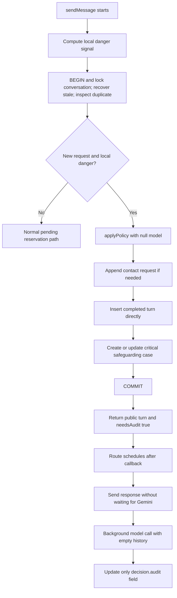

Only **local** danger detection enables this early path. A danger signal discovered only by Gemini takes the normal path and its model latency.

A crisis can be inserted as completed even when another ordinary turn remains pending. The partial pending-turn index permits this because the crisis row is not pending. Atomic saving guarantees the completed crisis turn and case commit together. It does not guarantee database availability: if PostgreSQL is unavailable, neither can be saved.

Deferred audit failures are swallowed by the route's empty `.catch`. `after` is subject to execution limits and is not a durable job queue. A retry returning an existing completed crisis turn reports `needsAudit:false`; it does not reschedule an audit missed after the original save.

## 10. Model request, context and retry conditions

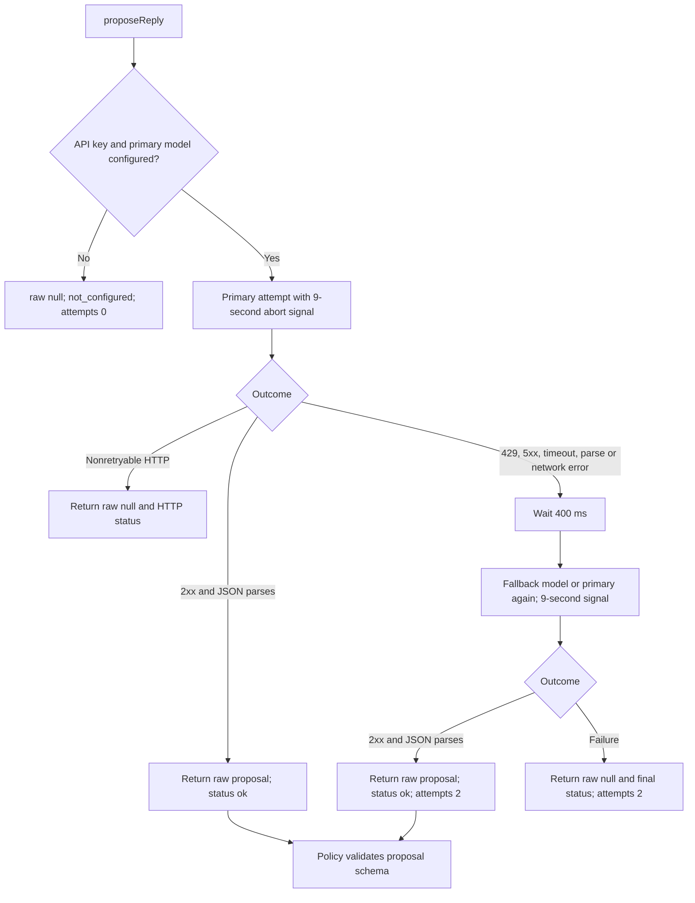

The request goes to the Gemini REST `generateContent` endpoint with the API key in `x-goog-api-key`. The model name is URL-encoded. The model names come from environment configuration; no particular model name is fixed in this module.

Payload contains system instructions and one JSON-encoded data object: all `approvedGuidance`, redacted `dialogue`, and redacted `latestStudentMessage`. Email and phone-like strings are replaced before transmission. Names, addresses and all other identifying details are not comprehensively removed.

Generation configuration requests JSON with `z.toJSONSchema(proposalSchema)`, at most 1,200 output tokens and temperature 0.3. Model names starting with `gemini-3` get minimal thinking; names starting with `gemini-2.5-flash` get thinking budget zero.

The instructions describe tone, approved-only guidance, no invented outcomes, how to classify messages, escalation reasons, and treating dialogue as data. These instructions are a first layer; deterministic policy is the enforcement layer.

Important distinction: syntactically invalid JSON triggers retry. Syntactically valid JSON that violates `proposalSchema` returns as `ok` from the adapter and is rejected later by policy, **without a schema-driven retry**. HTTP 400/401/403 are not retried; 429 and 5xx are. The adapter records only the final status/model/attempt count, not a full per-attempt trace. The abort signal is not a guarantee that the external provider stopped computation.

## 11. Proposal schema and final decision

| Field | Allowed values / constraint | Meaning |
|---|---|---|
| category | academic, financial, visa_or_immigration, housing, health_or_wellbeing, other | Topic |
| urgency | low, medium, high, critical | Priority; ordering is array index |
| safeguarding | boolean | Sensitive risk needing human attention |
| disposition | handle_now, clarify, escalate | Model's suggested action |
| possibleImmediateDanger | boolean | Model's danger signal |
| humanReason | none, risk, regulated_advice, insufficient_coverage, serious_financial_need, student_request, uncertainty | Why human input is required |
| messageKind | support, chat, spam, abuse, injection | Message classification |
| reply | string length 1–1,800 | Proposed student response |
| summary | string length 1–700 | Proposed staff summary |
| factIds | string array, maximum six | Approved entries relied on |

The object is strict: extra fields cause rejection. Known resource IDs are checked separately in `checkedDraft`, not by the string-array schema. `Decision` extends the proposal concept with disposition `ignored` and a machine-readable `reason`. `StoredDecision` adds optional audit data.

`publicTurn` exposes only ID, student text, reply, disposition, emergency flag, resolved resource cards, state and creation time. Category, urgency, safeguarding, summary, reason and raw audit are not sent in the student public projection. Staff detail exposes selected triage fields and the conversation, but not the raw audit proposal.

## 12. Complete policy decision tree

Rules run top to bottom; the first returned decision wins. Schema parsing and draft checking happen first.

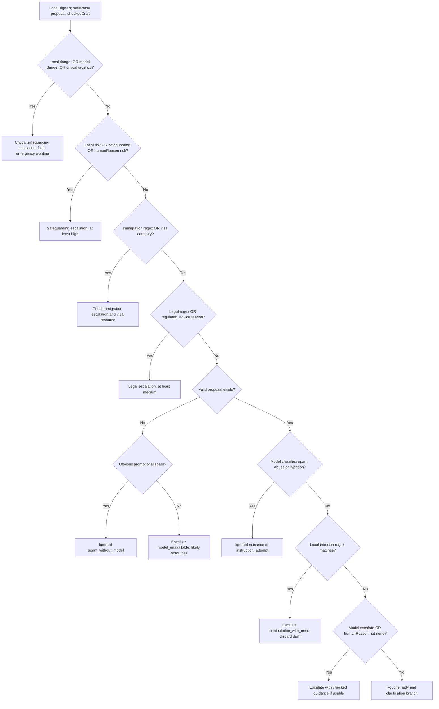

Exact branch conditions and results:

| Order | Condition | Result |
|---|---|---|
| 1 | `signals.danger || p.possibleImmediateDanger || p.urgency==='critical'` | `possible_immediate_danger`; critical, safeguarding true, humanReason risk. Medical local signal selects ambulance-first wording and emergency resource; otherwise fixed emotional-crisis wording and emergency/support resources. Category uses model category only when model danger flag is true; otherwise health/wellbeing. |
| 2 | Local risk, model safeguarding or model humanReason risk | `safeguarding`; urgency max(existing, high), safeguarding true. Use checked draft or local harassment/wellbeing fallback and matching resource. |
| 3 | Visa/immigration/CAS/BRP/work-rights/Home Office/asylum/deportation/overstay text, or visa category | `regulated_advice`; fixed visa wording, visa resource, urgency at least medium or high for time-sensitive wording. |
| 4 | Legal advice/lawyer/court/tribunal/eviction/small claims or deposit-dispute pattern, or regulated_advice reason | `regulated_advice`; at least medium. Use checked general guidance, otherwise restrained fallback; deposit-like wording gets deposit resource. |
| 5 | Proposal schema failed or raw null | Spam regex → ignored; otherwise `model_unavailable`, uncertainty escalation. Urgency high for time-sensitive/asap/due/now text, otherwise medium. Up to two guessed resource cards. |
| 6a | Model messageKind spam/abuse/injection | Ignored. Medium urgency, no safeguarding, no case; reason nuisance or instruction_attempt. |
| 6b | Local injection regex with non-nuisance model classification | `manipulation_with_need`; at least medium, uncertainty escalation, draft discarded. |
| 7 | Model disposition escalate OR any non-none humanReason | Escalate; reason is humanReason or uncertainty; checked draft if available. |
| 8 | None above | Routine branch in next section. |

`TIME_SENSITIVE` recognises expiry/withdrawal/refusal/urgent stems, tomorrow, today, this week, and digit-plus-day expressions. It is a regex, not a calendar parser.

Priority order matters: a message containing danger and manipulation reaches rule 1 before nuisance handling. However, if earlier rules do not trigger and the model mislabels a genuine need as nuisance, rule 6a can ignore it. The implementation does not independently prove every mixed-need message is recognised.

The escalation builder strips offers to escalate, supplies a default acknowledgement when guidance is absent, appends the server-owned handoff sentence and builds a summary. It uses the model summary only when the model's own disposition was escalate; otherwise it quotes the student's first 450 characters. Ignored outcomes use a fixed student-support boundary response.

## 13. Reply validation and fallback tree

`checkedDraft` is a heuristic wording gate, not a proof that every sentence is supported by the cited facts.

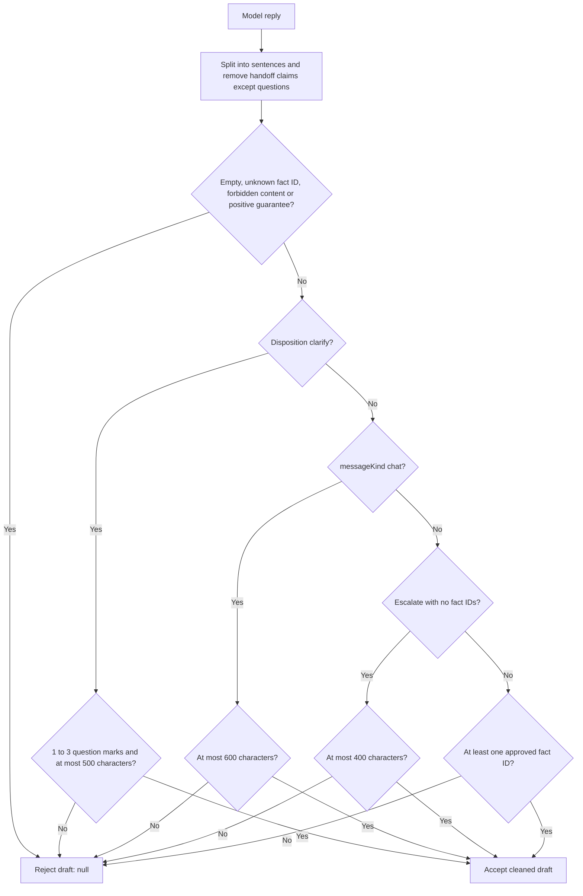

Forbidden patterns include raw HTTP/www links, `/resources/` links in prose, currency-symbol amounts, selected eligibility/entitlement/status verdicts, selected numeric response-time promises and positive guarantees. Negated guarantee expressions are discounted. Handoff-claim removal prevents many model claims of already having notified staff. Regex coverage is finite; equivalent wording can evade it.

Routine decision branch:

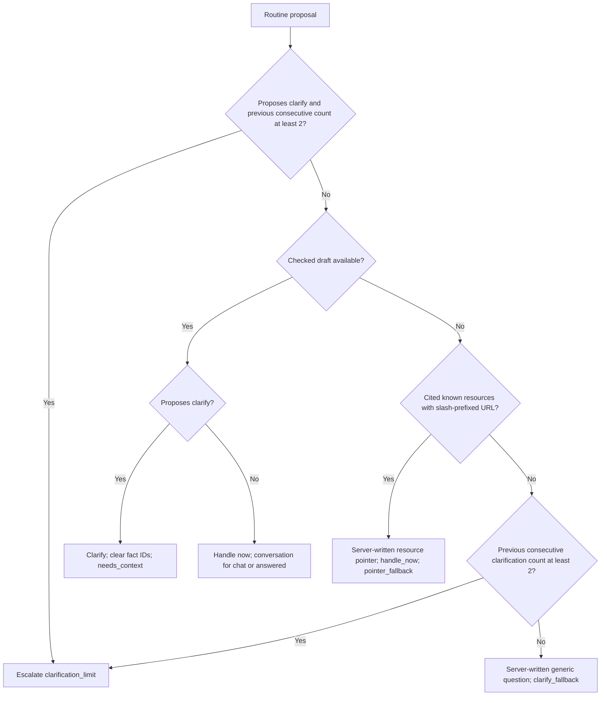

The limit checks the previous count, so two clarification replies may be saved; the next attempted clarification escalates. A usable normal answer can still be returned after two prior clarifications. External/phone-only resources are not eligible for the routine pointer fallback because its filter requires URLs starting `/`.

## 14. Local risk detection

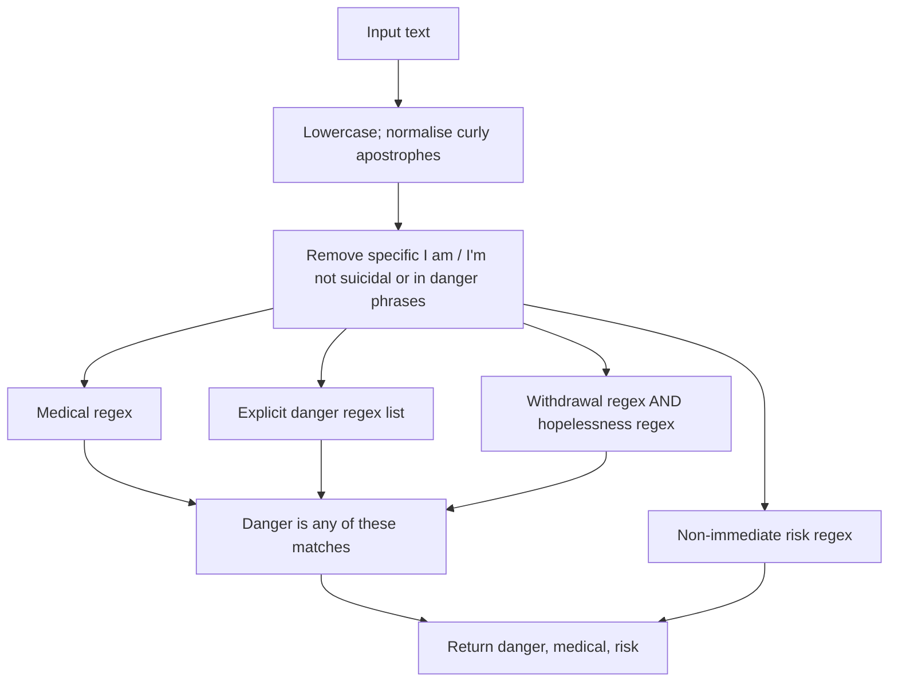

Medical signals include selected bleeding, breathing, chest-pain, unconsciousness, overdose, seizure, serious-injury and vehicle-accident phrases. Explicit danger includes selected self-harm/life-threatening statements, inability to stay safe and immediate threats. Withdrawal plus hopelessness also raises danger. Risk includes harassment, bullying, stalking, assault, abuse, self-harm, inability to cope, crisis, panic attacks and selected worsening-mental-health wording.

`risk` is `danger OR riskRegex`, so every locally dangerous message is also locally risky. A non-match does not establish safety. Negation handling covers only specific phrases; it is not general language understanding. Browser use supplies immediate presentation; server use determines authoritative policy.

The application contains UK-specific emergency/support wording and destinations. This document explains that implementation rather than verifying those destinations for other countries or giving personal crisis guidance.

## 15. Knowledge base and resource cards

| ID | Guidance topic | Destination kind |
|---|---|---|
| visa | Student visa/CAS | External GOV.UK link |
| hardship | Financial hardship | Internal-style resource path |
| deposit | Tenancy deposit | Internal-style resource path |
| library | Past papers and reading lists | Internal-style resource path |
| mitigation | Extenuating circumstances | Internal-style resource path |
| it | Accounts and IT | Internal-style resource path |
| disability | Additional learning support | Internal-style resource path |
| fees | Tuition/payment plans | Internal-style resource path |
| careers | CVs/jobs/work-related signposting | Internal-style resource path |
| wellbeing | Non-urgent wellbeing | Internal-style resource path |
| report | Harassment/reporting | Internal-style resource path |
| samaritans | Urgent emotional-support resource | Phone |
| emergency | Emergency-services resource | Phone |

Every model request receives all 13 entries, projected to ID/title/link/facts. There are no embeddings, vector database, semantic retrieval or model training steps. `suggestResources` is used only for outage fallback, never to select the model's input or determine routing.

Outage hints check hardship, fees, library, mitigation, IT, deposit, careers, disability and wellbeing patterns in that fixed order, then take the first two matches. That order is not a learned relevance score.

`resourceCards(ids)` filters the approved catalogue and returns ID/title/URL; unknown IDs disappear. Phone strings become `tel:` URLs with spaces removed. Output follows catalogue order, not necessarily model ID order. UI opens HTTPS and phone resources as anchors. Other resource paths are displayed as title/path text, not clickable internal pages. The repository does not implement those `/resources/*` pages.

## 16. Database model and invariants

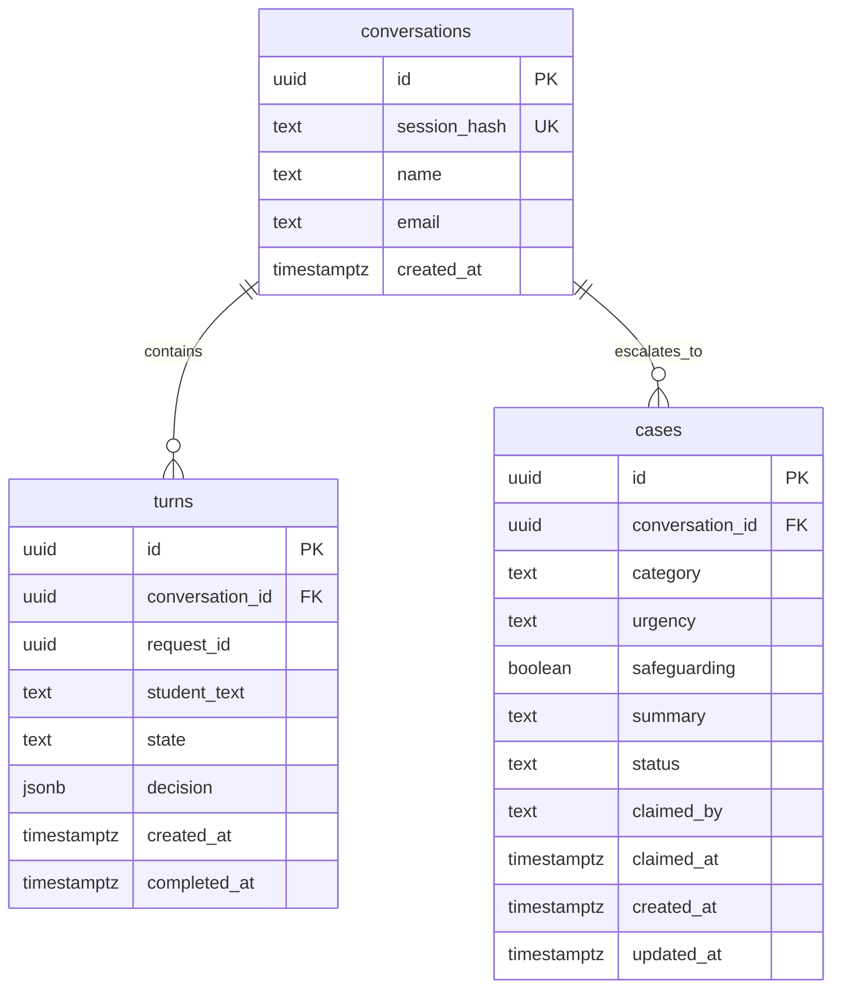

| Database rule | Purpose |
|---|---|
| Primary UUID keys | Stable identity of rows |
| Unique conversation session_hash | One conversation per token hash |
| Foreign keys from turns/cases | Child rows must reference an existing conversation |
| Unique `(conversation_id, request_id)` | Same operation cannot insert a second turn in that conversation |
| Partial unique `one_pending_turn` | At most one pending turn per conversation |
| Turn state check | Only pending/completed |
| Case urgency check | Only low/medium/high/critical |
| Case status check | Only new/in_progress/resolved |
| Status/owner check | New has no owner; in-progress/resolved require owner |
| Partial unique `one_active_case` | At most one non-resolved case per conversation |

Case category is text without a SQL category-enum constraint. `claimed_by` is text without a foreign key to a staff table. The schema does not require completed turns to have a non-null decision or enforce every JSON decision field. Those are application-level expectations. There is no `ON DELETE CASCADE` or retention job here.

JSONB stores evolving decision/audit structure; case priority/status columns remain typed/filterable relational fields. A separate `schema_migrations` bookkeeping table is created by the migration runner.

## 17. Transactions, retries and abandoned requests

### Database connection lifecycle

`database()` checks `DATABASE_URL` and lazily caches a `pg.Pool` on `globalThis`. Per instance: maximum three connections, five-second connection timeout and ten-second query timeout. Hot reload can reuse the pool. Separate server processes/instances still have separate pools; total connections scale with instance count.

`transaction(work)` checks out one connection, executes BEGIN, awaits work, COMMITs on success, ROLLBACKs on failure and releases in `finally`. All queries needing one transaction must use that supplied client, not unrelated pool queries.

### Reservation decisions

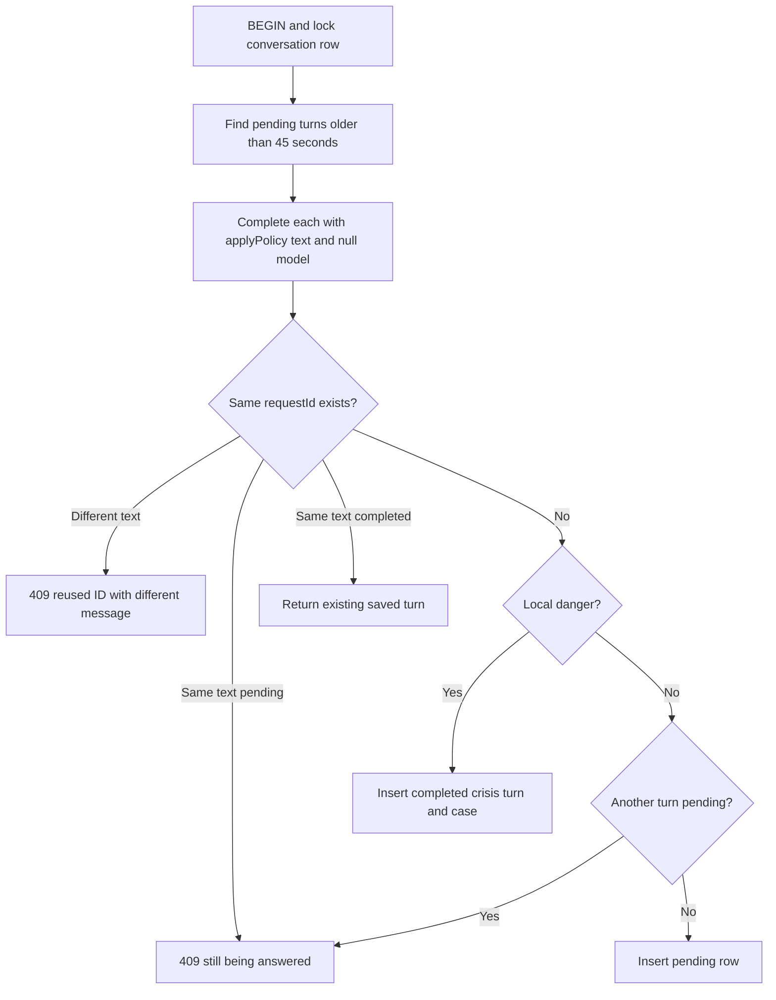

Stale recovery happens only on a subsequent `sendMessage` call for that conversation. There is no timer/worker scanning abandoned turns. Recovery applies policy with null model; most support messages escalate, but obvious spam can be ignored. If the surrounding reservation transaction later throws, its recovery work rolls back too.

`completeTurn` conditionally updates only `state='pending'`. This is compare-and-set behavior: a later worker cannot overwrite a row already completed by recovery. Case upsert runs only when that conditional update changed a row and the decision escalates.

### Completion and resolution lock nuance

Reservation locks the conversation; crisis saving and recovery execute under that lock. Normal finalisation starts a fresh transaction but does **not** explicitly lock the conversation row again. `upsertCase` locks an existing open case, and the partial unique index protects one active case. `resolveCase` locks the conversation, but this alone does not serialise every normal finalisation path. A resolution/upsert interleaving can encounter an open-case query whose target becomes resolved and then create a new case. Treat the comment that the conversation lock eliminates all escalation/resolution races as stronger than the implementation proves. A consistent lock order across finalisation and resolution would make this easier to reason about.

## 18. Case creation and priority accumulation

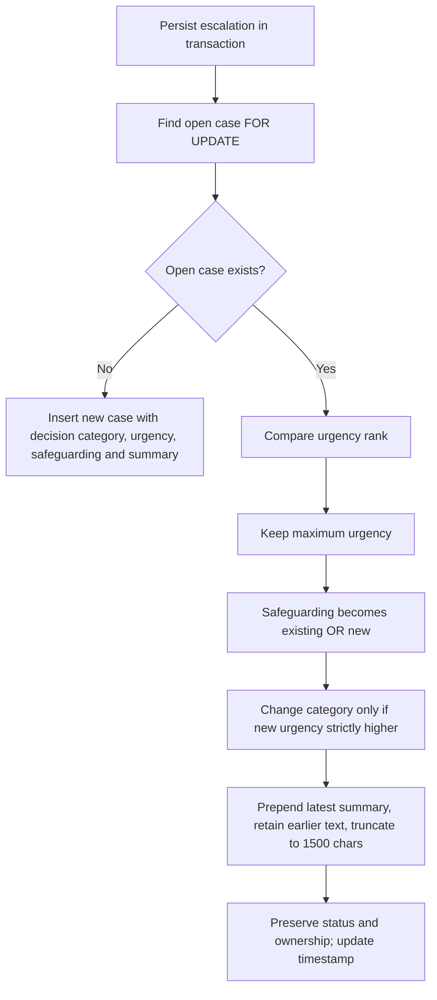

A calmer follow-up cannot downgrade an active case's urgency or clear safeguarding through this helper. Latest summary text is prepended even if its urgency is lower. The code does not sort summary fragments by severity, and truncation can discard older context. The full turn history remains available separately.

After resolution, a later escalation may create a new case because the uniqueness rule covers only active cases. An ordinary handle-now follow-up does not close an existing case. Claiming does not change urgency, safeguarding or category.

The normal service checks for an open case before saving to adjust acknowledgement wording; this read is not atomic with final upsert. The crisis path uses its priority wording directly and does not perform that existing-request replacement.

## 19. Staff authentication and dashboard

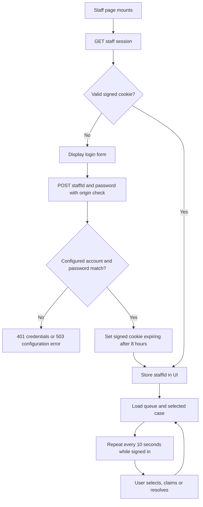

Demo identities map `alex` to `STAFF_A_PASSWORD` and `bea` to `STAFF_B_PASSWORD`. Passwords are compared through SHA-256 digests and `timingSafeEqual`, so comparison inputs have fixed equal length. This is not a persisted password-hashing/account system.

Cookie payload is base64url JSON `{id,expires}` plus HMAC-SHA256 signature using `SESSION_SECRET` of at least 32 characters. Base64 is encoding, not encryption. On requests, the server checks signature, recognised ID and future expiry. The staff ID for writes comes from this verified cookie, not the submitted body. Logout deletes the browser cookie; there is no server-side revocation store for copied signed tokens.

Cookies use HttpOnly, SameSite strict, path `/`, and Secure when NODE_ENV is production. HttpOnly prevents JavaScript reading the token; it does not prevent all consequences of XSS, including authenticated requests made by injected code.

Dashboard maintains staff identity, cases, selected detail, error and busy state. A `selectedId` reference prevents a response for an old case selection replacing the currently selected case. This guard does not order every possible overlapping refresh for the same case. Polling uses intervals rather than WebSockets. Claim/resolve actions refresh in `finally`, including after conflicts. Logout clears local UI even if its HTTP call fails.

Queue summary counts only non-resolved cases; the list itself includes resolved records at the end. Case detail displays contact details, badges, summary, ownership/actions and all conversation turns. Only the owner sees the resolve button, and the server enforces ownership independently.

## 20. Claiming, resolving and concurrency

### Case state machine

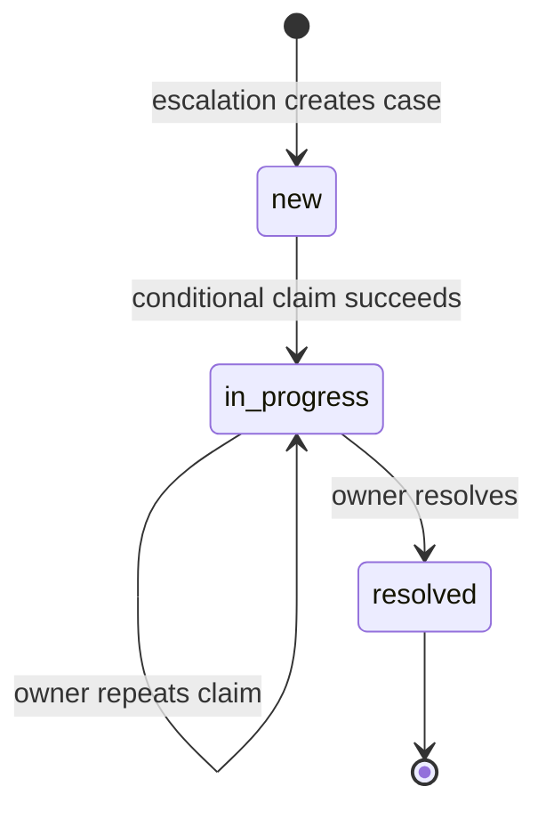

There is no unclaim, reassignment or reopen operation. A future escalation creates another case instead of reopening the resolved one.

### Two staff claim simultaneously

```mermaid
sequenceDiagram
  participant A as Alex
  participant D as PostgreSQL
  participant B as Bea
  A->>D: UPDATE where new AND claimed_by IS NULL
  B->>D: Same conditional UPDATE
  Note over D: One updater acquires the row lock first
  D-->>A: One updated row; owner Alex
  Note over D: Other updater rechecks predicate after waiting
  D-->>B: Zero updated rows
  B->>D: Read current case
  D-->>B: Already claimed by Alex
```

Alex is illustrative; either request can win. The safety mechanism is the single conditional UPDATE, not the disabled UI button.

Claim outcomes: success returns row; missing case 404; same owner with in-progress case returns row again; resolved case 409; another owner 409. Resolve outcomes: missing case 404; otherwise transaction locks conversation and updates only matching in-progress owner; zero rows produces 409. Repeating resolve is therefore a conflict, unlike repeating an owner's claim.

Queue ordering, in exact priority sequence:

1. Non-resolved before resolved.
2. Critical before other urgencies.
3. Safeguarding true before false.
4. Urgency critical → high → medium → low.
5. New/unclaimed before in-progress within equal priority.
6. Older creation time first.

The explicit safeguarding sort means a safeguarding high case precedes a non-safeguarding high case. Sorting has no final ID tie-breaker, so identical timestamps/priority need not have stable relative order.

## 21. Errors, security and privacy boundaries

| Status | Triggers in this application |
|---|---|
| 200 | Successful response, including saved fallback/ignored decisions |
| 400 | JSON parse/schema failure or invalid case UUID |
| 401 | Missing/invalid session or wrong staff password |
| 403 | Origin mismatch, including missing Origin on guarded writes |
| 404 | Case does not exist |
| 409 | Duplicate-ID mismatch, pending turn, ownership/status conflict |
| 413 | Body string exceeds helper limit |
| 503 | Unexpected server error or explicit missing server configuration |

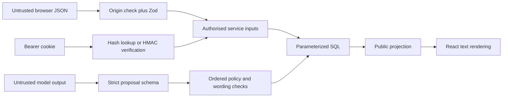

Parameterized SQL keeps values separate from SQL syntax. It does not replace authorisation. Strict request schemas reject attempts to submit staff owner/case status fields. Prompt-injection defenses include data/instruction separation, schema restrictions, local injection detection, deterministic policy and separation of model logic from staff endpoints.

Important limits: no rate limiting, staff SSO/MFA, comprehensive access audit, automated data retention, multi-tenant isolation or on-call notification is implemented. Sensitive text and raw proposals are stored in PostgreSQL. Redaction is partial and only for model-bound text. `api()` logs unexpected error messages; although it does not return stack traces to the browser, error messages still require care. Student startup currently logs the returned conversation to the browser console.

Origin checking compares headers with the request URL origin and rejects absent headers. It is CSRF defense for browser writes, not proof that a client is trustworthy. Reverse-proxy/host configuration can affect that comparison and should be tested in the deployment environment.

## 22. Configuration, migration and deployment

### Dependencies

| Package | Role |
|---|---|
| Next.js | Routing, app framework, build/runtime, cookies and deferred work |
| React / React DOM | Stateful UI and rendering |
| pg | PostgreSQL driver, clients, connection pool |
| Zod | Input/model runtime schemas and provider JSON-schema conversion |
| TypeScript | Static checking; no direct runtime validation |
| tsx | Execute TypeScript tests/scripts under Node |
| @types packages | Compile-time declarations for Node, React and pg |

`package.json` declares version ranges, not a guarantee of the exact installed versions. Consult the installed Next.js docs before edits, as AGENTS.md requires.

### Environment variables used by application code

| Variable | Purpose | If absent |
|---|---|---|
| DATABASE_URL | PostgreSQL connection | Database helper throws |
| GEMINI_API_KEY | Provider authentication | Model result not_configured, then policy fallback |
| GEMINI_MODEL | Primary model name | Same not_configured behavior |
| GEMINI_FALLBACK_MODEL | Second model | Reuse primary for second attempt |
| SESSION_SECRET | Staff cookie signature | Staff signing/verification requiring sign fails with configuration error |
| STAFF_A_PASSWORD | Alex's demo password | Alex login configuration error |
| STAFF_B_PASSWORD | Bea's demo password | Bea login configuration error |
| NODE_ENV | Production cookie Secure flag | Non-production does not require Secure |

Secrets should remain server-side; this guide intentionally includes no secret values. Runtime reads environment variables; the migration/test commands explicitly load `.env.local` using Node flags.

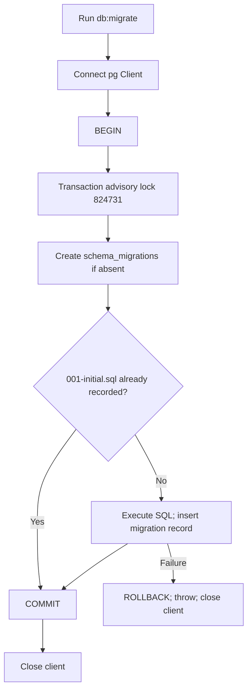

The migration runner currently names one migration explicitly; it is not a general directory-scanning migration engine. The advisory lock prevents simultaneous runners from racing its version check.

Commands: `npm run dev` starts development; `npm run build` builds; `npm start` serves a production build; `npm run typecheck` checks TypeScript. In a serverless deployment, each instance has its own pool; a pooled PostgreSQL endpoint can help connection management. There is no separate worker, cache service or message broker in the current architecture.

## 23. Tests and evidence

| Command | What it exercises | External dependencies |
|---|---|---|
| `npm test` | Policy tests and probes with recorded model proposals | No live model/database |
| `npm run probe` | Injection and crisis assessment probes | No live model/database |
| `npm run typecheck` | TypeScript compatibility | Installed dependencies |
| `npm run test:db` | Service persistence, crisis-before-model, retry, concurrency, recovery | Real PostgreSQL; stubbed model |
| `npm run test:http` | Build, run app, HTTP authentication/origin/session/concurrent-claim checks plus service checks | Real PostgreSQL and local app process; HTTP model config disabled |
| `npm run eval:model` | Nine assessment examples against configured live Gemini and writes evaluation JSON | Live provider credentials/network |

Integration tests create a unique database schema, point pools at its search path, apply SQL and drop the schema in cleanup. HTTP checks launch a local production app with test credentials. They are not load tests and do not prove all interleavings.

Policy checks cover local danger/model-only danger, selected negations, worsening mental health, harassment, immigration, deposit disputes, outage resources, spam, wording checks, clarification limits, chat, physical emergencies, summaries and manipulation mixed with support.

Recorded model proposals test server behavior even when the model is wrong. Live evaluation samples model behavior at a point in time; it does not guarantee future answers or safety on unseen language. This guide was checked against source. For this documentation update, the Markdown structure check found 25 numbered sections, 19 Mermaid diagrams and balanced code fences. Diagrams were not visually rendered. `npm test` was attempted but both test files failed during tsx startup because Node's `uv_os_get_passwd` returned ENOMEM; application assertions did not execute. Database and live-provider tests were not run.

## 24. Worked examples and limitations

### A. Routine academic request

Student asks where to find past papers → valid session → reserve pending turn → model sees approved guidance and recent dialogue → proposal cites library → policy finds no higher-priority condition → checked draft passes → handle_now → complete turn without case → public resource card → UI displays reply. This depends on the actual proposal; the model can instead ask a question or recommend escalation.

### B. Missing model configuration

Normal question → reserve → adapter returns null/not_configured/0 attempts → higher-priority local safety/legal/visa checks still run → otherwise outage policy suggests likely resources and escalates with medium/high urgency → turn and case saved together. An outage increases staff workload even for routine questions.

### C. Local immediate-danger signal

Browser detects local danger and displays the configured banner → server independently detects it → reserve transaction saves completed critical turn plus safeguarding case → reply returned → deferred model call records audit only. Database failure still prevents persistence; browser display is not evidence a case was saved.

### D. Lost response and retry

Server saves completed turn but connection drops → UI restores text and remembers request ID → retry with unchanged text → service finds matching completed request and returns it → browser removes duplicate turn ID before appending. If still pending, retry gets 409. If the page reloads, the in-memory retry reference is lost; startup transcript is the durable recovery view.

### E. Staff resolution followed by new need

Owner resolves a case → resolved history remains → later escalated turn finds no active case → new case created. Later ordinary guidance alone does not change the old case or create a new one.

### F. Manipulation attempt

Model is asked to mark a case resolved → schema has no case-status capability; no staff operation is called from policy. Earlier local/model risk checks can escalate. A nuisance classification is ignored; a locally detected injection with support classification escalates while discarding the draft. The existing active case is not downgraded through these paths.

### Engineering gaps to understand before extending the system

| Current behavior/limit | Engineering implication or possible next step |
|---|---|
| Regex detection and wording filters | Cannot prove semantic safety/grounding; broaden evaluation and specialist review |
| Any model critical urgency triggers emergency policy | Conservative behavior can create false positives |
| Valid but schema-invalid JSON does not retry | Add explicit validation/retry only if desired, with latency/cost tradeoff |
| Full-body read before length check | Implement true streamed byte limit or enforce gateway limits |
| No runtime response schema in browser | Validate successful responses to avoid accepting malformed 2xx payloads |
| Recovery only when another message arrives | Add durable recovery/monitoring if abandoned turns must be handled without student action |
| Deferred audit best effort and swallowed errors | Durable jobs and observable failures if audit completeness matters |
| Normal completion lacks conversation lock | Align lock discipline with resolution to make case transitions easier to guarantee |
| Polling and unbounded queue/transcript queries | Add pagination, appropriate indexes and measured polling strategy as volume grows |
| No email/paging | Implement actual notification workflow; case save alone is not human acknowledgement |
| In-memory retry ID | Consider persistent client outbox if cross-reload retry identity is needed |
| Concurrent first-time startup without a cookie | More than one conversation can be created; only a browser-retained cookie selects the later session |
| Demo credentials and signed cookies | SSO/MFA, revocation and proper account lifecycle for production use |
| Partial redaction and stored welfare data | Define privacy, retention, access auditing and provider arrangements |
| Single-organisation schema | Add tenant identity and enforce isolation before multi-organisation deployment |
| Placeholder resource paths | Connect real destinations or implement resource pages |

These are observations and possible future work, not changes made by this document.

## 25. Reading order and glossary

For line-by-line study, follow the dependency chain rather than opening files randomly:

1. `package.json` and `tsconfig.json`: framework, scripts, static checking.
2. `src/lib/client-api.ts`: what crosses HTTP.
3. `src/app/api/chat/route.ts`: server entry point.
4. `src/lib/http.ts`: validation, exceptions and responses.
5. `src/lib/auth.ts`: cookie identity and access boundaries.
6. `db/001-initial.sql` and `src/lib/db.ts`: persistence and transactions.
7. `src/lib/triage-schema.ts`: data contract.
8. `src/lib/safety.ts`: local signals.
9. `src/data/knowledge-base.json` and `src/lib/catalogue.ts`: approved information.
10. `src/lib/model.ts`: provider request and retry control.
11. `src/lib/policy.ts`: rule order and safe reply branches.
12. `src/lib/conversation-service.ts`: combine those pieces into one durable turn.
13. Conversation endpoint, student page and composer: startup and UI state.
14. Staff endpoints, `staff-service.ts` and staff page: ownership and concurrent operations.
15. Migration script and tests: setup and evidence for invariants.

| Concept | Concrete example |
|---|---|
| Async/await | Wait for DB/provider result while allowing other server work |
| Dependency injection | `sendMessage(..., model=proposeReply)` allows tests to provide a stub model |
| Runtime validation | Zod rejects a browser string where a UUID is required |
| Compile-time type | `PublicTurn` helps TypeScript check UI code but does not validate network JSON |
| Atomicity | Turn completion and case update commit together |
| Idempotency key | `(conversation_id, request_id)` uniquely identifies one message operation |
| Compare-and-set | UPDATE only when state is pending or case is new |
| Monotonic priority | Active case urgency never decreases through upsertCase |
| Projection | publicTurn removes internal decision/audit details from student response |
| Failover | Second provider attempt uses configured fallback model |
| Fallback | Server-written wording/resources replace unavailable or rejected model output |
| Trust boundary | Browser JSON and provider JSON both require validation |

The most useful engineering exercise is to pick one request, identify every state it reads/writes, then ask what happens if the process fails immediately before or after each write. The diagrams above supply those checkpoints.
